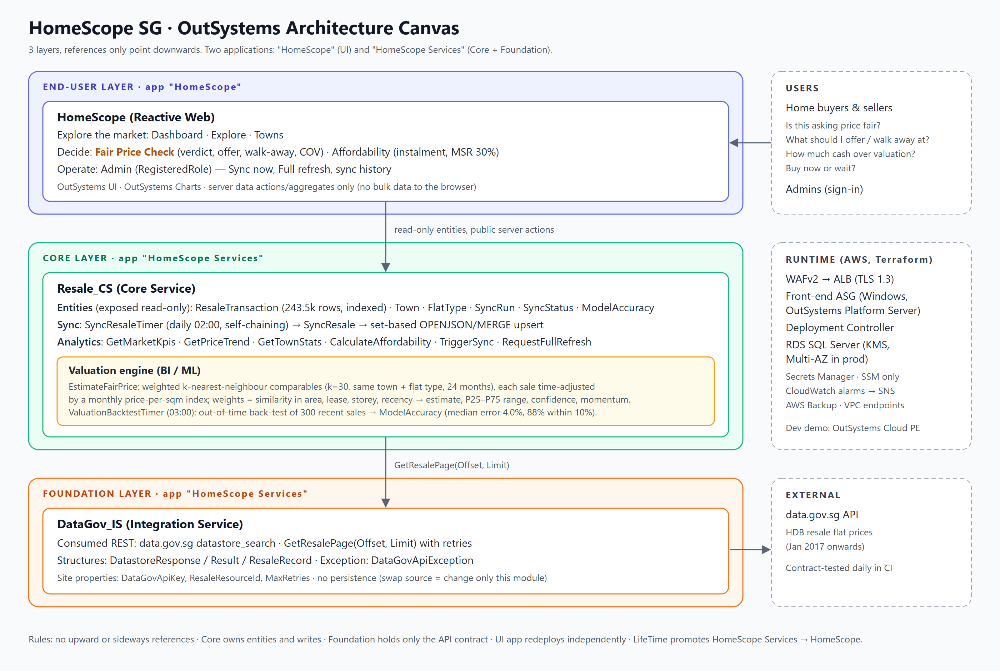

# HomeScope SG Architecture

## 1. Architecture Canvas (3 layers)



Text version:

```
┌──────────────────────────── End-user ────────────────────────────┐
│  HomeScope  (Reactive Web app "HomeScope")                       │
│  Screens: Dashboard · Explore · Towns · Fair Price ·             │
│           Affordability · Admin                                  │
└───────────────────────────────┬──────────────────────────────────┘
                                │ public read-only entities, server actions
┌──────────────────────────── Core ────────────────────────────────┐
│  Resale_CS   (app "HomeScope Services")                          │
│  Entities: ResaleTransaction, Town, FlatType, SyncRun,           │
│            SyncStatus, ModelAccuracy                             │
│  Logic: SyncResale + SyncResaleTimer, TriggerSync,               │
│         RequestFullRefresh, GetMarketKpis, GetPriceTrend,        │
│         GetTownStats, CalculateAffordability                     │
│  Valuation: EstimateFairPrice, BacktestFairPrice,                │
│             ComputeValuationBacktest + ValuationBacktestTimer    │
│  Rules: ClassifyVerdict · REST RulesAPI (Verdict, Affordability, │
│         SyncSelfTest) · role HomeScopeAdmin                      │
└───────────────────────────────┬──────────────────────────────────┘
                                │ GetResalePage(Offset, Limit)
┌──────────────────────────── Foundation ──────────────────────────┐
│  DataGov_IS  (app "HomeScope Services")                          │
│  Consumed REST API: data.gov.sg datastore_search                 │
│  Structures: DatastoreResponse/Result, ResaleRecord              │
│  Site props: DataGovApiKey, ResaleResourceId, MaxRetries         │
│  Exception: DataGovApiException                                  │
└──────────────────────────────────────────────────────────────────┘
```

Rules applied:

- No upward or sideways references. HomeScope → Resale_CS → DataGov_IS.
- The integration service (`_IS`) holds only the API contract, its typed structures and error translation. It has no persistence, so a different source or API version only changes this module.
- The core service (`_CS`) owns the business entities. It exposes them **read-only** (`ExposeReadOnly = true`), so all writes go through its own logic.
- The two services ship together as the application **HomeScope Services**. The UI ships as the application **HomeScope**, so the UI can be redeployed on its own.

## 2. Data model (Resale_CS)

| Entity | Purpose | Key / indexes |
|---|---|---|
| `ResaleTransaction` | One typed resale transaction (month, town, flat type, block, street, storey range, min/max storey, floor area, model, lease start, remaining lease in months, price, price per sqm, `LastSeenOn` for the full-refresh sweep) | `UX_ResaleTx_SourceRecordId` (unique, idempotent upsert key = data.gov.sg `_id`); `IX_ResaleTx_Town_FlatType_Month`; `IX_ResaleTx_Month` |
| `Town` / `FlatType` | Normalised reference data, created automatically during sync | unique `Name` |
| `SyncRun` | Audit row per sync: trigger, offsets, pages, fetched/inserted/updated/deleted, source total, error | – |
| `SyncStatus` (static) | Running · Succeeded · Failed | – |
| `ModelAccuracy` | One row per nightly back-test of the valuation model: samples, median absolute error %, share within 5% / 10%, naive-baseline median error %, P25–P75 interval coverage % | `IX_ModelAccuracy_ComputedOn` |

Price per sqm and min/max storey are computed during ingestion, so analytics queries never parse strings.

## 3. Ingestion / sync design

```
SyncResaleTimer (daily 02:00, or woken by Admin › Sync now)
  └─ SyncResale
       create SyncRun(Running)
       Offset = Site.FullRefreshOffset >= 0 ? FullRefreshOffset    -- full refresh in progress
                                            : COUNT(ResaleTransaction)  -- incremental resume point
       loop while HasMore and Page < Site.MaxPagesPerRun (10)
         DataGov_IS.GetResalePage(Offset, Site.SyncPageSize = 5000)
           (429 / 5xx: retry up to MaxRetries with 2/4/8/15 s backoff, then DataGovApiException)
         UpsertResalePage: ONE set-based SQL batch
           OPENJSON(page) → typed temp table → insert new Town / FlatType
           → UPDATE rows whose values differ (NULL-safe INTERSECT test)
           → INSERT new SourceRecordIds → stamp LastSeenOn on every received row
         CommitTransaction                           -- each page is durable
         Offset += page size; HasMore = Offset < Total
       if a full refresh just finished:
         seen >= 98% of SourceTotal ? DELETE rows with LastSeenOn < FullRefreshStartedOn
                                    : delete nothing, record a warning on the SyncRun
       SyncRun = Succeeded
       if HasMore → WakeSyncResaleTimer               -- chain the next batch
  on exception → SyncRun = Failed (+ message), logged, not rethrown
```

Design choices:

- **Bounded runs.** Each run handles at most 50,000 rows and then re-wakes its own timer. Runs stay far inside the timer timeout, and the ~243k-row initial load needs about five chained runs.
- **Idempotent.** The upsert is keyed on `SourceRecordId`. Re-running a page, or overlapping runs, cannot create duplicates, and unchanged rows are not rewritten. The Rules API `SyncSelfTest` proves this on the server inside a rolled-back transaction.
- **Set-based.** Each page is one SQL round trip, not 5,000 aggregate calls. A page of 5,000 rows loads in seconds.
- **Commit per page.** If a run fails midway, the pages already loaded are kept, and the next run resumes from the current row count.
- **Observable.** The SyncRun history appears on the Admin screen.
- **Full refresh (mark-and-sweep).** Admin › Full refresh asks for confirmation. `RequestFullRefresh` then sets `FullRefreshStartedOn` and `FullRefreshOffset = 0` and wakes the timer. The data stays online throughout: rows are updated in place. Rows missing from the source are deleted only after the whole pass, and only if it saw at least 98% of the source, so a truncated upstream response can never empty the table.
- **Trade-off.** Using the row count as the incremental offset assumes the dataset is append-only in `_id` order, which holds for this data.gov.sg resource. A full refresh corrects any retro edits upstream.

## 4. Frontend design (HomeScope)

| Screen | Purpose | Main elements |
|---|---|---|
| Dashboard (default) | Market at a glance | Filters (town, flat type, period); KPI cards (transactions, median/avg price, price per sqm); price trend line chart; volume by flat type bar chart |
| Explore | Transaction-level exploration | Search (street, block or flat model; ignored under 3 characters to avoid wildcard scans), town, flat type; server-side sort (`OnSort` → dynamic ORDER BY) and pagination (20/page) |
| Towns | Compare towns | Bar chart of median price by town; sortable stats table; flat-type filter |
| Fair Price | "Is this asking price fair, and what should I offer?" | Town, flat type, area, storey, lease, asking price → verdict banner (below / fair / above / overpriced), fair value and P25–P75 range, confidence, negotiation plan (opening offer, walk-away, COV, 6-month momentum), the 10 most similar sales with match %, back-test accuracy |
| Affordability | "Can I afford it?" | Price, down payment, interest, tenure, income → monthly instalment (annuity formula), MSR check against 30% |
| Admin (`HomeScopeAdmin`) | Operations | Sync now, Full refresh with an inline confirmation, SyncRun history. The menu shows the link only to admins; every admin server action re-checks the role |

UX choices:

- Each screen fetches data through **server aggregates and data actions**, so only the current page or the aggregates reach the browser, never the 243k rows.
- Filters refresh their data sources on change. Empty states are shown before the first sync.
- Fair Price and Affordability validate their inputs on the client before calling the server. The server actions validate again and raise `InvalidInput`.
- The screens use the OutSystems UI responsive layout, with a hamburger menu on mobile.

## 4a. Decision support: Fair Price Check (BI / ML)

The other screens describe the market. Fair Price turns the same data into a decision for one specific flat.

**Model (Resale_CS.EstimateFairPrice, weighted k-nearest-neighbour regression on comparable sales):**

1. Candidates: sales of the same town and flat type in the last 24 months.
2. Each sale's price per sqm is brought to today's level with a monthly median-psm index for the flat type.
3. Similarity weight = 1 / (1 + |Δarea|/10 + |Δlease yrs|/5 + |Δstorey|/6 + months ago/12). The 30 most similar sales are kept.
4. Estimate = weighted mean adjusted psm × floor area. Fair range = P25–P75 of the adjusted prices. Confidence is High at ≥20 comparables with spread ≤15%, Medium at ≥10 with spread ≤25%, otherwise Low. Fewer than 5 comparables gives no verdict.

**From estimate to decision:**

| Output | Rule | Decision it informs |
|---|---|---|
| Verdict | gap = asking / estimate − 1: ≤ −5% below, ≤ +5% fair, ≤ +10% above, else overpriced | Pursue, negotiate or walk away |
| Opening offer | midpoint of P25 and the estimate | First offer to make |
| Walk-away price | min(asking, P75) | The highest price to accept (above it you pay more than 3 in 4 comparable buyers) |
| Cash over valuation | max(0, asking − estimate) | Cash needed on top of the loan (loans only cover the valuation) |
| 6-month momentum | change in the flat-type index | Buy now or wait |

**Trust:** `ValuationBacktestTimer` (daily 03:00, or woken when no current result from the last 2 days exists) re-values a deterministic sample of 300 recent sales, using only data from before each sale. The sample is ordered by `CHECKSUM(CAST(Id AS BIGINT) * 7919)`: stable between runs and spread across towns. It runs exactly the production logic, with the index averaged over months M-1 to M-3 and the same 24-month comparables, weights and rounding.

It stores in `ModelAccuracy`, and the screen shows:

- the median absolute error;
- the share of estimates within 5% and within 10%;
- the **naive baseline**: the median error of "town and flat-type median price per sqm of the prior 12 months × area", to show what the model adds;
- the **interval coverage**: the share of actual prices inside the P25–P75 fair range. The verdict relies on that range, so it has to be calibrated, not only the point estimate.

The back-test runs in a timer because it takes longer than a screen request is allowed to.

**Latest result (25 Oct 2026, Dev, 300 sales):** median error **4.0%** against **17.6%** for the naive baseline, 87% within 10%, and 57% of actual prices inside the P25–P75 range (the nominal rate for an interquartile range is 50%, so the range is about right, slightly wide).

## 5. Infrastructure (AWS, self-managed OutSystems 11)

```
                Internet
                   │  (WAFv2: rate limit, IP reputation, OWASP common, SQLi)
            ┌──────▼──────┐  public subnets (2–3 AZ)
            │     ALB      │  TLS 1.3, HTTP→HTTPS, blocks /ServiceCenter /LifeTime /ServiceStudio
            └──────┬──────┘
   app subnets     │ :80
   ┌───────────────▼───────────────┐      ┌─────────────────────┐
   │ Front-end ASG (Windows 2022,  │◄────►│ Deployment Controller│  (EC2, auto-recover,
   │ IIS + OutSystems Platform     │ 12000│ + Service Center     │   AWS Backup daily)
   │ Server; lifecycle-hook ready) │ 5672 │ controller.<env>.internal (private zone)
   └───────────────┬───────────────┘      └──────────┬──────────┘
   data subnets    │ 1433 (TLS forced)               │
            ┌──────▼─────────────────────────────────▼─┐
            │ RDS SQL Server SE (KMS, Multi-AZ in prod,│
            │ Secrets Manager master password, PI, EM) │
            └──────────────────────────────────────────┘
 VPC endpoints: S3 (gateway), SSM, SSM Messages, EC2 Messages, Secrets Manager, Logs, Monitoring
 S3: artifacts (installers, server.hsconf template), logs (ALB, VPC flow logs)
 CloudWatch: IIS / platform / Windows logs, alarms → SNS, ops dashboard
```

- **Bootstrap.** Each server runs `bootstrap.ps1` from user data. The script is idempotent:
  1. Formats the D: data disk.
  2. Installs IIS and .NET.
  3. Installs the Platform Server.
  4. Renders `server.hsconf` and runs `ConfigurationTool.com /SetupInstall`.
  5. On the controller only, installs Service Center.
  6. Starts the CloudWatch agent.
- **Front-end readiness.** A new front-end joins the target group only after `/HomeScope/` answers, through the ASG lifecycle hook. Rolling instance refresh gives zero-downtime AMI and config updates.
- **No inbound admin ports.** Admin access is through SSM Session Manager only. Database passwords are generated by Terraform and kept in Secrets Manager.
- **Environments.** `envs/dev.tfvars` is cost-optimised: 2 AZs, a single NAT and one front-end. `envs/prod.tfvars` is highly available: 3 AZs, a NAT per AZ, Multi-AZ RDS, 2–6 front-ends and deletion protection. `envs/test.tfvars` is dev-sized (2 AZs, 1–2 front-ends, single-AZ RDS), and `envs/lifetime.tfvars` is a controller-only LifeTime console with no public app paths.

## 6. Delivery pipeline

```
PR / push ──► CI: terraform fmt+validate+test, tflint, checkov (hard fail)
                  │ unit (lifetime-deploy) │ rules API │ contract (data.gov.sg) │ Playwright e2e (Dev)
manual    ──► Deploy <lifetime | dev | test | prod>:
                  plan (read-only role, plan in run summary) ─► apply the reviewed plan (approval gate)
                  ─► LifeTime: Dev→Test (tag) or Test→Prod (same version, unmodified), Services before UI
                  ─► SSM /homescope-<env>/release ─► smoke tests on the target
daily     ──► CI contract tests: detect upstream data.gov.sg schema drift
```

Test layers: unit (pipeline script, mocked) → rules (server business logic through REST) → contract (upstream API) → e2e (UI, desktop and mobile). Terraform has plan-only `terraform test` suites for the prod guardrails, the platform module and LifeTime. Environments: `lifetime` (the LifeTime console, private) manages `dev` → `test` → `prod`, each with its own VPC, tfvars and state.
